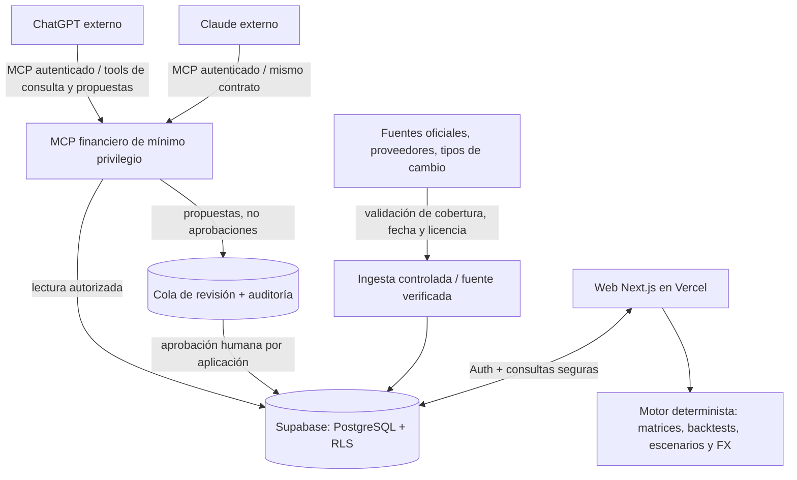

# Arquitectura conceptual MVP — v1.0 (pendiente de implementación)

## Separación de responsabilidades

| Componente | Sí hace | No hace en MVP |
|---|---|---|
| ChatGPT / Claude | Investigar, explicar, proponer registros con fuentes, consultar datos vía MCP | Correr dentro de la web ni autorizar compras |
| MCP financiero | Herramientas limitadas con validación, permisos y auditoría | Exponer SQL genérico o secretos de Supabase |
| Supabase | Auth, RLS, almacenamiento de ETF/listings/snapshots/noticias/FX/decisiones/revisiones | Inventar datos financieros ni reemplazar a la IA |
| Next.js/React en Vercel | Pantallas, cálculos verificables, flujos de aprobación, exportaciones | Ejecutar LLM por API en MVP |
| Proveedores | Precios, documentos, composición y tipos de cambio con condiciones de licencia | Garantizar cobertura sin discovery previo |
| GitHub | Versionar, revisar cambios, documentar QA y controlar releases | Reemplazar la aprobación del PO |

## Entidades conceptuales por diseñar en BF-010 y posteriores

`instrument` (ISIN, gestora, índice) → `listing` (ticker, exchange, currency) → `price_observation` (fecha, close, adjusted/total_return, provenance); `fund_snapshot` (atributos + fecha); `fx_observation` (par USD/PEN + fecha); `source_record` (URL/título, fecha, licencia); `news_item`; `analysis_record`; `comparison`; `simulation`; `decision`; `change_proposal`; `audit_log`.

Una misma etiqueta ticker puede corresponder a listings distintos: **el identificador del fondo NO es el ticker**. Los snapshots se versionan y conservan la fecha efectiva de los datos.

## Flujo MCP seguro

1. Herramienta `search_instruments(query)` encuentra instrumentos/listings y devuelve IDs, campos y fuentes aprobadas.
2. `get_instrument_profile(instrument_id)` devuelve snapshots y vigencia; no requiere privilegios de administración.
3. `get_comparison_data(instrument_ids, as_of_date)` devuelve datos auditables y marca no comparables.
4. `submit_research_proposal(payload)` valida identidad, enlaces, campos, límites e idempotency key; crea propuesta, no altera contenido aprobado.
5. La web permite al PO revisar diferencias, corregir y aprobar o rechazar; backend autorizado aplica la actualización y registra auditoría.

Los nombres anteriores son **contratos propuestos**, no endpoints existentes. En BF-017 se concretarán esquemas y autenticación según las capacidades reales de cada cliente MCP. No usar el MCP de administración de Supabase como conector abierto de datos financieros.

## Política de datos y cálculos

- **Ingesta:** priorizar fuentes oficiales para ficha y proveedores con licencia para precios históricos; GPT/Claude pueden investigar, pero no son fuente de precios por sí mismos.
- **Frescura:** todas las vistas muestran fecha de actualización; si una serie o FX está incompleto se advierte.
- **Rentabilidad:** distinguir precio, ajustado y total return, y política de acumulación/distribución del fondo. No asumir que ETF de acumulación distribuye ingresos en efectivo.
- **Backtest:** fijar ventana, listing, divisa, aportes, costos asumidos y política de fechas no hábiles; escenarios futuros nunca son predicción.
- **USD/PEN:** convertir inversión/aportes/resultado según fecha y fuente, documentar efectos cambiarios y precisión; no convertir todo con FX actual.
- **Fuentes:** cada observación debe vincular origen, licencia, timestamps de captura/efectividad; no afirmar que hay API gratuita con datos de todos los ETF sin comprobarlo.

## Seguridad preliminar

- Solo un usuario autorizado, sin signup público. Aplicar políticas RLS y ownership en datos privados.
- Publicable/anon key solo cuando sea seguro y con RLS; nunca service_role/token MCP en cliente. Preferir credenciales distintas por entorno y tool.
- Escrituras externas pasan validación y aceptación humana; registros aprobados no se sobreescriben sin histórico.
- Logs sin PII/secrets; backups y migraciones reversibles en despliegue; no usar servicios productivos hasta aprobación.

## Incertidumbres por resolver (product discovery)

1. Proveedor con cobertura y derechos de uso suficientes para series VWRA/FWRA; retrasos/plan/pagos.
2. Política de días no hábiles para aportes, FX y benchmark: se documentará y probará antes de implementar.
3. Tratamiento de dividendos, split/corporate actions y costos reales del bróker: nivel de datos permitido por fuente.
4. Autenticación intercliente MCP y aprobaciones de herramientas en ChatGPT/Claude: primero prueba de concepto aislada.
5. Diferencia entre guardar hallazgo resumido y guardar contenido de terceros sujeto a derechos de reproducción.